<div align="center">



<br/>

# .NET Machine Learning Lab

**A comprehensive collection of 20+ Machine Learning, Computer Vision, NLP, and Generative AI projects — all in C# and .NET**

[](https://dotnet.microsoft.com/)
[](https://learn.microsoft.com/en-us/dotnet/csharp/)
[](https://onnxruntime.ai/)
[](https://dotnet.microsoft.com/apps/machinelearning-ai/ml-dotnet)
[](LICENSE)

</div>

---

## Overview

This repository demonstrates how to build real-world **Machine Learning** and **AI** applications using the **.NET ecosystem**. It covers a wide range of domains — from image classification and object detection to large language models and speech recognition — all implemented in **C#** with production-grade libraries.

---

## Table of Contents

- [Project Catalog](#project-catalog)
  - [Computer Vision](#-computer-vision)
  - [Large Language Models & Generative AI](#-large-language-models--generative-ai)
  - [Natural Language Processing](#-natural-language-processing)
  - [Speech & OCR](#-speech--ocr)
  - [Semantic Kernel](#-semantic-kernel)
  - [Utilities](#-utilities)
- [Tech Stack](#tech-stack)
- [Prerequisites](#prerequisites)
- [Getting Started](#getting-started)
- [License](#license)

---

## Project Catalog

### 🔍 Computer Vision

| Project | Description | Key Packages |
|---------|-------------|--------------|
| **[`ImageClassification`](ImageClassification/)** | TensorFlow Inception model for ImageNet classification (1000 classes) | ML.NET, TensorFlow.NET |
| **[`tf_image_classification`](tf_image_classification/)** | TensorFlow image scoring via ML.NET integration | ML.NET 3.0, TensorFlow.NET 2.16 |
| **[`mlnet_image_classification`](mlnet_image_classification/)** | Deep learning CNN training for concrete crack detection (SDNET2018 dataset) | ML.NET 4.0, ML.NET Vision |
| **[`object_detection`](object_detection/)** | Real-time object detection with Faster R-CNN — detects 80 COCO object categories | ONNX Runtime 1.16, ImageSharp |
| **[`nsfw`](nsfw/)** | NSFW content classifier using a fine-tuned Vision Transformer (ViT) | ONNX Runtime, ImageSharp |
| **[`florence_2`](florence_2/)** | Multi-task vision foundation model — OCR, captioning, object detection, segmentation | Florence2, ONNX Runtime 1.18 |
| **[`dalle3`](dalle3/)** | DALL-E 3 text-to-image generation via Semantic Kernel | Semantic Kernel 1.19, SkiaSharp |

### 🤖 Large Language Models & Generative AI

| Project | Description | Key Packages |
|---------|-------------|--------------|
| **[`phi3`](phi3/)** | Interactive Phi-3-mini chatbot with local ONNX inference (4K context) | OnnxRuntimeGenAI 0.3 |
| **[`phi3vision`](phi3vision/)** | Phi-3 Vision 128K multimodal model — understands text + images | OnnxRuntimeGenAI, Spectre.Console |
| **[`ai_toolkit`](ai_toolkit/)** | AI Toolkit inference with Phi-3-mini-128k (quantized INT4 ONNX) | OnnxRuntimeGenAI, DirectML, CUDA |
| **[`bert_onnx`](bert_onnx/)** | BERT large-uncased question-answering with ONNX Runtime | BERTTokenizers, ONNX Runtime, ML.NET |
| **[`torchsharp`](torchsharp/)** | Sentiment analysis using TorchSharp (PyTorch bindings for .NET) | ML.NET TorchSharp 0.22 |

### 🌐 Natural Language Processing

| Project | Description | Key Packages |
|---------|-------------|--------------|
| **[`cld_3`](cld_3/)** | Language detection using Google's Compact Language Detector 3 (100+ languages) | Panlingo CLD3 |
| **[`fasttext`](fasttext/)** | Language identification using Facebook's FastText (176+ languages) | Panlingo FastText |

### 🎙️ Speech & OCR

| Project | Description | Key Packages |
|---------|-------------|--------------|
| **[`whisper_net`](whisper_net/)** | ASP.NET Core Web API for speech-to-text using OpenAI Whisper | Whisper.net 1.7, NAudio |
| **[`tesseract_dotnet`](tesseract_dotnet/)** | Optical Character Recognition with multi-language support | TesseractOCR 5.3, Spectre.Console |

### 🧠 Semantic Kernel

A suite of projects demonstrating [Microsoft Semantic Kernel](https://github.com/microsoft/semantic-kernel) — the SDK that integrates LLMs with conventional programming languages.

| Project | Description | Key Packages |
|---------|-------------|--------------|
| **[`semantic_kernel/sk1`](semantic_kernel/sk1/)** | Chat with Azure OpenAI using prompts & plugins | Semantic Kernel 1.15 |
| **[`semantic_kernel/Chroma_app`](semantic_kernel/Chroma_app/)** | RAG with Chroma vector database for semantic memory | SK Connectors.Chroma |
| **[`semantic_kernel/native_functions`](semantic_kernel/native_functions/)** | Extend LLMs with native C# plugins (e.g., MusicLibrary) | Semantic Kernel 1.16 |
| **[`semantic_kernel/ollamasharp`](semantic_kernel/ollamasharp/)** | Run Phi-3 locally via Ollama + Semantic Kernel | OllamaSharp 2.0 |
| **[`semantic_kernel/phi3_sk`](semantic_kernel/phi3_sk/)** | Phi-3 ONNX integrated with Semantic Kernel via custom connector | SK + OnnxRuntimeGenAI |
| **[`semantic_kernel/planners`](semantic_kernel/planners/)** | AI Planners — automatic plugin orchestration with Handlebars | SK Planners.Handlebars |
| **[`semantic_kernel/dalle3`](semantic_kernel/dalle3/)** | DALL-E 3 image generation through Semantic Kernel | Semantic Kernel 1.19 |

### 🛠️ Utilities

| Project | Description | Key Packages |
|---------|-------------|--------------|
| **[`extract_images`](extract_images/)** | Extract images from PDF, DOCX, PPTX, ODT, HTML, RTF documents | GroupDocs.Parser |
| **[`mime`](mime/)** | MIME type detection by inspecting file content (magic bytes) | Mime-Detective |

---

## Tech Stack

| Category | Technologies |
|----------|-------------|
| **Runtime** | .NET 8.0 (C# 12) |
| **ML Frameworks** | ML.NET, TorchSharp, TensorFlow.NET |
| **Inference Engines** | ONNX Runtime, OnnxRuntimeGenAI |
| **LLMs** | Phi-3, Phi-3 Vision, BERT, GPT (via Azure OpenAI) |
| **Orchestration** | Microsoft Semantic Kernel, Handlebars Planners |
| **Vision Models** | Florence-2, Faster R-CNN, ViT, Inception |
| **Speech** | Whisper.net (OpenAI Whisper) |
| **OCR** | Tesseract, Florence-2 |
| **Image Processing** | SixLabors.ImageSharp, SkiaSharp |
| **Vector Stores** | Chroma DB |
| **Web** | ASP.NET Core, Kestrel |
| **Containers** | Docker (Whisper API, Ollama, Chroma) |

---

## Prerequisites

- [.NET 8.0 SDK](https://dotnet.microsoft.com/download/dotnet/8.0) (or .NET Core 2.1 for legacy `ImageClassification` project)
- [Visual Studio 2022](https://visualstudio.microsoft.com/) or [VS Code](https://code.visualstudio.com/) with C# extension
- [Visual C++ Redistributable](https://aka.ms/vs/17/release/vc_redist.x64.exe) (required for Tesseract, ONNX Runtime)

**Model Downloads** (project-specific):

| Model | Download | Used By |
|-------|----------|---------|
| Phi-3 Mini ONNX | `huggingface-cli download microsoft/Phi-3-mini-4k-instruct-onnx --include cpu_and_mobile/cpu-int4-rtn-block-32-acc-level-4/* --local-dir .` | phi3, phi3_sk, ai_toolkit |
| Phi-3 Vision ONNX | `huggingface-cli download microsoft/Phi-3-vision-128k-instruct-onnx-cpu --include cpu-int4-rtn-block-32-acc-level-4/* --local-dir .` | phi3vision |
| BERT Large ONNX | [HuggingFace](https://huggingface.co/google-bert/bert-large-uncased-whole-word-masking-finetuned-squad) (convert to ONNX) | bert_onnx |
| Florence-2 ONNX | [florence2-sharp](https://github.com/curiosity-ai/florence2-sharp/tree/main) | florence_2 |
| FastText Models | [lid.176.bin](https://dl.fbaipublicfiles.com/fasttext/supervised-models/lid.176.bin) / [fasttext217.bin](https://huggingface.co/facebook/fasttext-language-identification/resolve/main/model.bin) | fasttext |
| Tesseract tessdata | [tessdata](https://github.com/tesseract-ocr/tessdata) | tesseract_dotnet |
| Whisper ggml-base | Auto-downloaded on first run | whisper_net |
| Faster R-CNN ONNX | [ONNX Model Zoo](https://github.com/onnx/models/tree/main/validated/vision/object_detection_segmentation/faster-rcnn) | object_detection |

**Optional Docker Services:**

```bash
# Ollama (for local LLM inference)
docker run -d --gpus=all -v ollama:/root/.ollama -p 11434:11434 --name ollama ollama/ollama
ollama run phi3

# Chroma (for vector store / RAG)
docker run -it --rm -p 8000:8000/tcp chromadb/chroma:latest
```

**API Keys** (for cloud-based projects):
- Azure OpenAI API key — required for `sk1`, `dalle3`, `planners`

---

## Getting Started

1. **Clone the repository**
   ```bash
   git clone https://github.com/your-username/DotNet_ML.git
   cd DotNet_ML
   ```

2. **Navigate to any project folder**
   ```bash
   cd phi3
   ```

3. **Restore dependencies and run**
   ```bash
   dotnet restore
   dotnet run
   ```

Each project is self-contained with its own `.sln` and `.csproj`. Refer to the project-specific section above for any required model downloads or configuration.

---

## License

This project is licensed under the terms of the [MIT License](LICENSE).